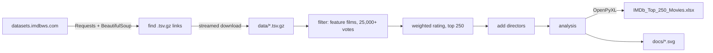
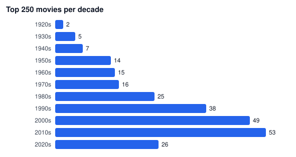
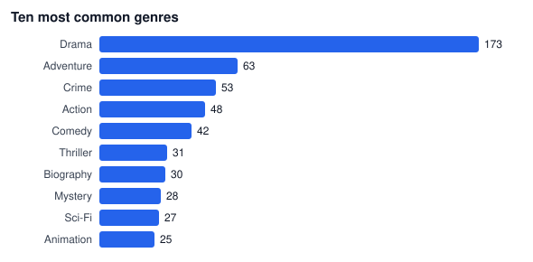

# IMDb Top 250 Movies

A Python tool that collects IMDb data with Requests and BeautifulSoup, builds the Top 250 movie list and exports it to a formatted Excel workbook with OpenPyXL. The workbook has a filterable movie table, live summary formulas and analysis sheets with charts.


## Features

- Finds the current IMDb dataset files by parsing the official dataset page with BeautifulSoup
- Downloads them with Requests (streamed to disk, skipped if less than a day old)
- Streams over 12 million title rows line by line, so it runs fine on a laptop with little RAM
- Ranks movies with the weighted rating formula IMDb used for its Top 250
- Looks up the directors for each movie
- Exports a 7 sheet Excel workbook:

| Sheet | Contents |
|-------|----------|
| Top 250 | Rank, title, original title, year, decade, runtime, genres, directors, rating, votes, weighted score, IMDb link. Excel table with sort and filter on every column, frozen header, color scale on rating |
| Summary | Live Excel formulas (`AVERAGE`, `MEDIAN`, `COUNTIF` ...) over the Top 250 sheet, so they update if you edit the data |
| By Decade | Movies and average rating per decade, with a bar chart and a line chart |
| By Genre | Movies per genre with a bar chart |
| Directors | Directors with two or more films in the list |
| Runtime | Movies grouped by length, with a bar chart |
| About | Data source, method and attribution |

## How it works



The ranking uses the formula IMDb published for the Top 250 for many years:

```
WR = v / (v + m) * R + m / (v + m) * C
```

`R` is the average rating, `v` the number of votes, `m` the minimum votes to be listed (25,000) and `C` the mean rating of all eligible movies. A film with few votes gets pulled toward the mean, so a 9.2 with 30,000 votes ranks below a 9.0 with 2 million.

## What the data shows

Results from a run on 10 October 2026 (7,305 feature films had 25,000+ votes):





- The top 5 is The Shawshank Redemption, The Godfather, The Dark Knight, The Return of the King and Schindler's List. Lower positions can differ a little from imdb.com, since IMDb's current formula is not public.
- More than half the list (128 movies) is from 2000 or later. The average rating barely changes by decade (8.20 to 8.42).
- 173 of 250 movies are tagged Drama.
- Christopher Nolan has the most films in the list (9), with the highest average rating among directors with 2+ films (8.52).
- Longer movies rate a little higher: 8.43 on average for 180+ minutes against 8.26 for 90-119 minutes.

## Setup

Requires Python 3.10 or newer.

```bash
git clone https://github.com/t4lh8/IMDb-Top-250-Movies.git
cd IMDb-Top-250-Movies
python -m venv .venv
.venv\Scripts\activate          # Windows
# source .venv/bin/activate     # Linux / macOS
pip install -r requirements.txt
```

## Usage

```bash
python -m imdbtop
```

The first run downloads about 630 MB of compressed data into `data/` and takes a couple of minutes. The workbook is written to `output/IMDb_Top_250_Movies.xlsx`.

| Option | Default | Description |
|--------|---------|-------------|
| `--out` | `output/IMDb_Top_250_Movies.xlsx` | Excel file to write |
| `--top` | `250` | Number of movies to keep |
| `--min-votes` | `25000` | Minimum votes to be listed |
| `--offline` | off | Use files already in `--data-dir` |
| `--force` | off | Download again even if the files are fresh |
| `--charts DIR` | off | Also write the README SVG charts |

## Tests

```bash
pip install -r requirements-dev.txt
ruff check .
pytest
```

The tests use a small fake dataset with the same column layout as IMDb's files, so they run in about a second without network access. They cover the link parsing, null values and stray quotes in the TSV files, the ranking order, director lookup, the analysis groups, the workbook layout and the command line. GitHub Actions runs them on Python 3.10, 3.12 and 3.13.

## Why not scrape the chart page directly?

The imdb.com chart page is behind a bot check and IMDb's conditions of use do not allow scraping it. IMDb publishes the same underlying data as daily dataset files for personal and non-commercial use, so this project parses that page instead. The Excel file and raw data are not committed to the repo for the same reason: run the tool to build your own copy.

## What I learned

- Reading large gzip files line by line keeps memory use low. Loading `title.basics` into memory at once would need several GB.
- IMDb's TSV files contain unescaped quote characters, which confuse the default quoting in Python's `csv` module. A plain split on tabs is correct here and faster.
- Excel refused to open the first version of the workbook. The table was named `Top250`, which Excel reads as cell `TOP250` (column TOP, row 250). Renaming it fixed it, and a test now checks the name.
- A `COUNTIF(range, ">=8.5")` formula returned 0 in Excel with Norwegian settings, because the text `"8.5"` is not a number when the decimal separator is a comma. `">="&8.5` works in every locale.
- A weighted rating needs a realistic data set to make sense. In a five movie test set, a film with 30,000 votes topped the list until I adjusted the test data.

## Data

Information courtesy of IMDb (https://www.imdb.com). Used with permission for personal and non-commercial use under the [IMDb dataset terms](https://developer.imdb.com/non-commercial-datasets/).

## License

MIT. See [LICENSE](LICENSE).

Made by Talha Aker
