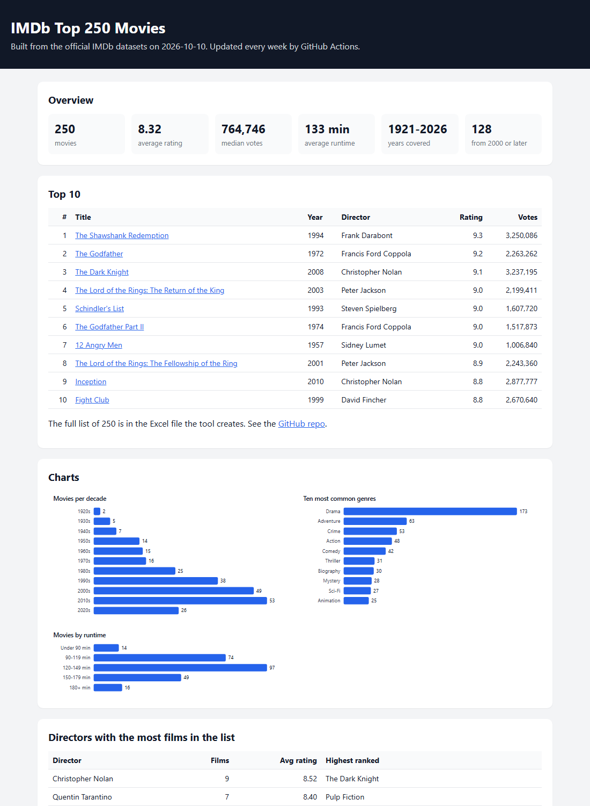

# IMDb Top 250 Movies


A Python tool that collects IMDb movie data, finds the 250 highest rated movies and saves them in an Excel file you can filter and analyze.

**Live page:** https://t4lh8.github.io/IMDb-Top-250-Movies/



## What it does

1. Downloads the official IMDb data files with **Requests**. **BeautifulSoup** reads IMDb's download page to find the file links.
2. Keeps feature films with at least 25,000 votes and ranks them, the same way IMDb's Top 250 works.
3. Saves the result to Excel with **OpenPyXL**.

## The Excel file

| Sheet | What is in it |
|-------|---------------|
| Top 250 | All 250 movies: title, year, runtime, genres, director, rating, votes and IMDb link. Sort and filter on every column |
| Summary | Key numbers as Excel formulas (average rating, total votes, movies after 2000 ...) |
| By Decade | Movies per decade, with charts |
| By Genre | Movies per genre, with a chart |
| Directors | Directors with two or more movies in the list |
| Runtime | Movies grouped by length, with a chart |

## How to run it

```bash
git clone https://github.com/t4lh8/IMDb-Top-250-Movies.git
cd IMDb-Top-250-Movies
pip install -r requirements.txt
python -m imdbtop
```

The Excel file is saved to `output/IMDb_Top_250_Movies.xlsx`. The first run downloads about 600 MB and takes a few minutes.

## Some results

- 128 of the 250 movies are from 2000 or later.
- 173 movies are dramas.
- Christopher Nolan has the most movies in the list (9).
- The oldest movie is The Kid (1921).


## Tests

```bash
pip install -r requirements-dev.txt
pytest
```

14 tests run on a small fake data set, so they need no internet. GitHub Actions runs them on every push.

## What I learned

- How to stream large files line by line instead of loading them into memory (one file has over 12 million rows).
- Excel would not open my first file. The table was named `Top250`, and Excel read that as a cell address (column TOP, row 250).
- A formula like `COUNTIF(range, ">=8.5")` breaks in Norwegian Excel, where the decimal sign is a comma.

## Note on the data

The imdb.com website does not allow scraping, so the tool uses IMDb's official data files instead. They are free for personal, non-commercial use. For that reason the full list is not published in this repo or on the live page, only the top 10 and the statistics.

Information courtesy of IMDb (https://www.imdb.com). Used with permission.

## License

MIT

Made by Talha Aker
